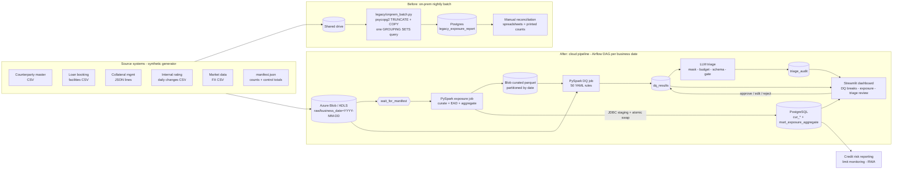

# Credit Exposure Aggregation & AI Data-Quality Triage

**PySpark · Azure Blob Storage · PostgreSQL · Airflow · LangChain + OpenAI · Streamlit**

This repo is a cloud pipeline that replaces an on-premises nightly batch. It sources counterparty, facility, collateral, rating-change and FX feeds and aggregates credit exposure (EAD and collateral-adjusted exposure) by **counterparty group, sector and rating band**. Credit risk reporting, limit monitoring and RWA capital calculations consume the results. Around the pipeline:

- a **config-driven data-quality engine**: 50 YAML rules covering completeness, validity, uniqueness, referential integrity, timeliness and source-to-target reconciliation. The same engine runs on pandas and on PySpark. Results go to a `dq_results` table and a Streamlit dashboard.
- an **LLM triage assistant** (LangChain + OpenAI) that classifies each data break and drafts a root-cause note. Identifiers are masked before any call, a token budget is enforced, output is checked against a schema, and low-confidence answers fall back to manual review. A human must approve every suggestion before anything is written back, and every prompt and output goes to an audit log.
- **measurement scripts** for the two claims that need evidence: agreement of the LLM with analyst labels, and the analyst time saved on reconciliation. Their results are written into this README. No numbers here are typed by hand.

All data is synthetic. A generator creates related feeds for about 5,000 counterparties, injects labelled defects and saves the ground truth.

---

## Architecture



### What changed in the migration

| | On-prem batch (`legacy/`) | Cloud pipeline |
|---|---|---|
| Storage | shared drive + one Postgres | Azure Blob/ADLS raw + curated parquet, Postgres serving layer |
| Loads | full TRUNCATE + reload, no history | incremental, partitioned by business date, idempotent delete-and-insert |
| Compute | single-threaded SQL | PySpark (local[*] or standalone cluster) |
| Orchestration | cron | Airflow: sensor on control file, retries, backfill (`catchup`) |
| Data quality | printed row counts, checked by hand | 50 declarative rules, results table, dashboard |
| Break triage | analyst notes in spreadsheets | LLM suggestions under human approval, full audit trail |
| Dedup | `DISTINCT ON` with no ORDER BY (arbitrary survivor) | deterministic keep-first in file order |

`scripts/parity_check.py` compares the legacy report with the new mart for the same date (the migration regression test).

---

## Data model and business rules

Feeds for each business date are written to `data/raw/business_date=YYYY-MM-DD/`:

| Feed | Key | Notes |
|---|---|---|
| `counterparties.csv` | counterparty_id | group_id, ultimate_parent_id, sector, internal rating (AAA to D), country, LEI |
| `facilities.csv` | facility_id | type, currency, limit, drawn, source system |
| `collateral.json` | collateral_id | newline-delimited JSON: facility_id, type, market value, haircut |
| `rating_changes.csv` | counterparty_id | daily migrations (delta feed) |
| `fx_rates.csv` | currency | rate to CHF |
| `manifest.json` | n/a | source control file: record counts, control totals, extract time. Written last |

Exposure logic is the same in pandas (`transform/pandas_impl.py`), Spark (`spark_jobs/transforms.py`) and the legacy SQL:

- **EAD (CHF)** = drawn + CCF × max(limit − drawn, 0), converted at the day's FX rate. The CCF table is illustrative, not a regulatory calculation.
- **Collateral** = market value × (1 − haircut) × FX. The haircut is clipped to [0, 1], and collateral recognised per facility is capped at EAD. **Net exposure** = EAD − collateral.
- Facilities whose counterparty is unknown go to an `UNMAPPED` bucket, and unrated counterparties go to `UNRATED`. Neither is dropped, so every dimension still sums to the same total, and a reconciliation rule checks that it does.

### Injected defects (ground truth in `data/labels/error_labels.csv`)

| Category | Examples injected |
|---|---|
| missing_source_data | null ratings/sectors/currencies/limits/valuations; truncated facility or counterparty file; JPY missing from FX |
| mapping_error | orphan counterparty/facility ids, legacy sector codes, agency rating codes (Baa2), non-ISO countries |
| stale_feed | previous day's rating or collateral file re-delivered |
| duplicate | duplicate and near-duplicate rows |
| unit_or_fx_mismatch | APAC loan system switching to thousands, GBX (pence) amounts, haircut sent as a percentage |
| genuine_business_change | multi-notch downgrades after a credit event (the data is correct, but the rule fires) |

Day 0 is clean, so there is always a last successful load to compare against. Record-level errors are injected *before* the control file is computed, because the source itself sent them. File-level incidents are applied *after*, which is what gives reconciliation something to catch. The same rule can break for different reasons (for example, an orphan id versus a truncated master file), so triage cannot work as a lookup from rule id to category.

---

## Data-quality engine

```
src/exposure_pipeline/dq/
  rules/*.yaml          # the rule catalogue (data, not code)
  rules.py              # loader + validation (unknown checks / missing params / duplicate ids fail fast)
  engine.py             # semantics: thresholds, tolerances, PASS/FAIL/ERROR, failing-key samples
  backends/pandas_backend.py, backends/spark_backend.py   # only filter/count/sum primitives
```

| Dimension | Rules | Check types |
|---|---|---|
| completeness | 10 | `min_row_count`, `not_null` |
| validity | 13 | `accepted_values` (literal or from a reference dataset), `pattern`, `range`, `compare_columns` |
| uniqueness | 4 | `unique` |
| referential integrity | 4 | `foreign_key` |
| timeliness | 5 | `freshness` (stale-feed detection) |
| reconciliation | 14 | `count_reconciliation`, `sum_reconciliation`: control file vs landed data, raw vs curated, curated vs every mart dimension |

Design points:

- A rule never crashes the run. A missing dataset or an evaluation error becomes an `ERROR` row, because a missing feed is a break someone has to look at.
- Validity rules ignore NULLs (completeness rules own them), so one defect raises one break.
- `result_id = <business_date>:<rule_id>` is deterministic. A rerun replaces results instead of duplicating them, and the triage history stays attached to the logical break.
- Each result stores up to 20 failing keys and 5 sample records. These feed the dashboard, the triage context and the evaluation.

Adding a rule is a YAML change, for example:

```yaml
- id: FAC_REF_001
  name: Facility counterparty exists in counterparty master
  dataset: raw.facilities
  dimension: referential_integrity
  check: foreign_key
  column: counterparty_id
  ref_dataset: raw.counterparties
  ref_column: counterparty_id
```

---

## LLM triage (human in the loop)

For each `FAIL`/`ERROR` row, `triage/context.py` builds the evidence an analyst would use: the rule definition, the measured result, sample failing records, feed metadata from the control file, the last successful load of that feed, and the other breaks on the same day. `triage/chain.py` then:

1. **masks** counterparty ids, group ids and LEIs with keyed HMAC tokens (`CP#1a2b...`) and removes names. A regex sweep covers ids embedded in strings, and a final leak check refuses to send any prompt that still contains an original value;
2. shrinks the context to fit a **token budget** (fewer sample rows or keys). If it still doesn't fit, no call is made;
3. calls OpenAI through LangChain at **temperature 0** with **structured output** (`TriageSuggestion`: category, confidence, root-cause note, suggested fix);
4. **re-validates** the output against the Pydantic schema. The model cannot return `needs_manual_review` or an unknown category;
5. applies a **confidence gate**. Below `TRIAGE_CONFIDENCE_THRESHOLD`, the suggestion becomes `needs_manual_review`, and the model's guess is kept in the audit log but not applied.

Any failure (timeout, rate limit, parse error, budget, leak) also produces `needs_manual_review` with a `fallback_reason`.

Every call is written to **`triage_audit`**: timestamp, requested model and the version the API returned, prompt version, temperature, prompt hash, the full masked prompt, the raw output, confidence, tokens, latency and cost. Reviewer columns are filled in later. The **Triage Review** page shows the evidence and the exact prompt. A named reviewer approves, edits or rejects, and only then are the category and note written to `dq_results`, in the same transaction. Reviews are write-once, and in Postgres a trigger makes the model-output columns immutable.

## Responsible AI use

**What is automated:** drafting a category and a root-cause note for each break, using masked evidence.

**What stays human:**
- accepting or changing the category and note;
- any fix to source data;
- any decision about reported exposure, limits or capital;
- sign-off of the daily run.

The model has no write access to anything. Its suggestions sit in an audit table until a named reviewer acts on them.

**Data protection**
- Counterparty identifiers are pseudonymised with a secret salt and names are removed before any API call. Prompts are checked for leaks before sending, and blocked prompts are not stored.
- Use a provider and deployment approved for confidential data. The code works with Azure OpenAI by swapping the chat model class.

**Reproducibility and accountability**
- Temperature 0, a versioned prompt (`PROMPT_VERSION`), and a prompt hash over model, prompt version and prompt text.
- The returned model version is logged with the full prompt and output.
- Every human decision is attributed and timestamped.

**Known failure modes and mitigations**

| Failure mode | Mitigation |
|---|---|
| Plausible but wrong root-cause notes (hallucination) | The prompt restricts the model to the given evidence; reviewers see the same evidence; notes are only ever drafts |
| Self-reported confidence is poorly calibrated | The eval reports agreement by confidence bucket; set the threshold from that, not from intuition |
| Ambiguous breaks (truncated master file vs orphan ids) | The context includes other breaks on the same day and the last successful load; a low-confidence fallback |
| Anchoring: reviewers rubber-stamp suggestions | The blind labelling sheet for evaluation hides model output; track the share of approvals without edits |
| Drift when rules or feeds change | Re-run the eval after rule changes; the prompt version and hash show which prompt produced which output |
| Prompt injection via free-text source fields | Data is passed as JSON inside a fenced block; the output schema is fixed; the model has no tools and no write access |
| Masking gaps (a new identifier field) | The field list plus regex sweep plus leak check; add new id fields to `guardrails.ID_FIELDS` |
| Provider outage or rate limits | Fallback to manual review; the pipeline and DQ do not depend on the LLM |

---

## Results (filled in by the scripts, not by hand)

### Triage agreement

<!-- RESULTS:triage_eval:start -->
_Not measured yet. Run triage on real breaks, label about 150 breaks in `eval/hand_labels.csv`, then run `python -m exposure_pipeline.triage.eval --update-readme`._
<!-- RESULTS:triage_eval:end -->

### Reconciliation effort

<!-- RESULTS:reconciliation_timing:start -->
_Not measured yet. Record manual and automated runs with `scripts/time_reconciliation.py record ...`, then run `scripts/time_reconciliation.py summary --update-readme`._
<!-- RESULTS:reconciliation_timing:end -->

---

## Setup

Requires Python 3.10+. Docker is optional and only needed for the full cloud-like stack.

```bash
python -m venv .venv && source .venv/bin/activate      # Windows: .venv\Scripts\activate
pip install -r requirements.txt
pip install -e .                                         # optional; tests and scripts also work from the repo root
cp .env.example .env                                     # then edit; never commit .env
```

Without Docker, set `DATABASE_URL=sqlite:///./data/local.db` and `STORAGE_BACKEND=local` in `.env` (if no `DATABASE_URL` is set at all, the code defaults to `data/local.db`).

## How to run each stage

**1. Generate synthetic feeds and labels**
```bash
python -m exposure_pipeline.generator.generate_feeds --counterparties 5000 --days 10 --seed 42
```

**2a. Laptop pipeline** (pandas curation + DQ, SQLite or Postgres)
```bash
python -m exposure_pipeline.local_pipeline --all
```

**2b. Legacy baseline** (needs Postgres)
```bash
python legacy/onprem_batch.py --input-dir data/raw/business_date=2026-01-05
python scripts/parity_check.py --business-date 2026-01-05     # after running the new pipeline for that date
```

**2c. Cloud stack** (Airflow + Spark + Azurite + Postgres)
```bash
docker compose up -d --build
python -m exposure_pipeline.storage.blob                       # host: upload partitions to Azurite (STORAGE_BACKEND=azurite)
# Airflow UI http://localhost:8080 -> unpause credit_exposure_daily (catchup backfills from 2026-01-05)
# or run a job directly:
docker compose exec airflow-scheduler spark-submit --packages "$SPARK_JARS_PACKAGES" \
  /opt/project/src/exposure_pipeline/spark_jobs/daily_exposure_job.py --business-date 2026-01-07
```
Spark reads `wasb://raw@devstoreaccount1.blob.core.windows.net/...`. In compose, that hostname is a network alias for the Azurite container, and Azurite parses the account name from it, so the same URL format works on real Azure. For ADLS Gen2 set `STORAGE_BACKEND=azure` and `AZURE_STORAGE_SCHEME=abfss`, with an account key or a service principal (see `.env.example`).

**3. Dashboard**
```bash
streamlit run dashboard/app.py          # DQ breaks | Exposure | Triage Review
```

**4. LLM triage suggestions** (needs `OPENAI_API_KEY`; it only suggests, nothing is applied)
```bash
python -m exposure_pipeline.triage.runner --business-date 2026-01-07 --limit 20
```
Then review the suggestions on the Triage Review page. In Airflow, set `TRIAGE_ENABLED=true` to generate suggestions after each DQ run.

**5. Evaluation**
```bash
python -m exposure_pipeline.triage.eval --export-sheet eval/labelling_sheet.csv   # blind sheet, no model output shown
# label ~150 rows, copy them into eval/hand_labels.csv
python -m exposure_pipeline.triage.eval --update-readme            # add --include-reviewer-labels to use dashboard decisions
```
The report covers agreement %, coverage, agreement on auto-triaged breaks, raw model agreement before the gate, per-class precision and recall, the confusion matrix, latency, and tokens and cost per break. Set `OPENAI_PRICE_*` for cost.

**6. Reconciliation effort**
```bash
python scripts/time_reconciliation.py protocol
python scripts/time_reconciliation.py record --mode manual --business-date 2026-01-07 --analyst <initials>
python scripts/time_reconciliation.py record --mode automated --business-date 2026-01-08 --analyst <initials>
python scripts/time_reconciliation.py summary --update-readme
```

## Tests

```bash
pytest
```
The tests cover:
- each DQ check type and the full catalogue on hand-built pandas fixtures;
- curation and EAD rules;
- generator, pipeline and labels end to end on a small universe, including idempotent reruns;
- masking, token budget, schema validation and confidence fallback with a mocked LLM;
- audit write-once behaviour, and no write-back before approval;
- the eval metrics;
- that the SQLAlchemy tables match the SQL DDL;
- Streamlit pages rendering headlessly.

Spark parity tests run when `pyspark` and Java are installed; otherwise they are skipped.

## Project structure

```
credit-exposure-pipeline/
├── dags/credit_exposure_daily.py          # Airflow DAG (sensor -> Spark exposure -> Spark DQ -> optional triage)
├── dashboard/                             # Streamlit: app.py (DQ breaks), pages/1_Exposure.py, pages/2_Triage_Review.py
├── docker/                                # airflow (Spark client + Java) and dashboard images
├── docker-compose.yml                     # postgres, azurite, airflow, spark master/worker, dashboard
├── eval/hand_labels.csv                   # analyst label slot (~150 breaks)
├── legacy/onprem_batch.py                 # on-prem baseline (psycopg2 + SQL)
├── scripts/                               # time_reconciliation.py, parity_check.py
├── sql/                                   # Postgres DDL: curated + mart + load_audit, dq_results, triage_audit
├── src/exposure_pipeline/
│   ├── config.py, reference.py, reporting.py, local_pipeline.py
│   ├── generator/                         # synthetic feeds + error injection + labels
│   ├── transform/pandas_impl.py           # reference curation/aggregation
│   ├── spark_jobs/                        # session (Azure/JDBC), transforms, daily_exposure_job, dq_job
│   ├── storage/                           # tables, idempotent DB writes, blob/ADLS locations
│   ├── dq/                                # engine, rules loader, pandas/Spark backends, rules/*.yaml
│   └── triage/                            # schemas, guardrails, context, chain, audit, runner, eval
└── tests/
```

## Limitations

- Synthetic data. The defect mix and rates are design choices, so agreement measured against generator labels says how well the model handles *these* defects. The hand-labelled set is the more meaningful number.
- EAD, CCF and collateral treatment are simplified and not CRR/Basel compliant. RWA itself is downstream and not implemented here.
- The Postgres serving layer uses delete-and-insert per date. At larger volumes, native table partitioning would be the next step.
- The Docker stack targets local development (LocalExecutor, one Postgres for metadata and data, the well-known Azurite key).

## License

MIT, © Mayank Sharma. See [LICENSE](LICENSE).
